# SlashBlade: Wakizashi & Dual Wield

[简体中文](README.md) | **English**

**Chain your blades. Meet an attack with your wakizashi. Put that second sword to work.**

By **R1sum_** · GitHub: **Resumresum**  
Version: `0.4.1-experimental` · Minecraft **26.1.2** · **Fabric** · Public prerelease

Land a cut with your main blade and let the offhand follow. Press **R** for eight alternating slashes, a simultaneous strike, and four alternating SA attacks to finish the sequence.

Or keep a wakizashi in your offhand: brace for a hit, sweep nearby enemies away with a counter, then decide whether to follow up with its SA. Move the wakizashi to your main hand for quick cuts and a dash into three rapid thrusts.

This is a combat addon for **SlashBlade: Refabricated**. It adds **one rebindable Offhand Blade Action key**, default **R**, whose action depends on your main-hand and offhand blades. You can also craft a smaller wakizashi from a supported long blade, keeping its appearance and ordinary SA, and let an offhand blade that joins the fight earn a share of its growth.

**Development disclosure:** Most code implementation, iteration, documentation, and automated verification were produced using **OpenAI Codex**. R1sum_ provides the gameplay ideas, feature decisions, in-game feedback, and release maintenance.

| Two long blades | Long blade + wakizashi |
| --- | --- |
| 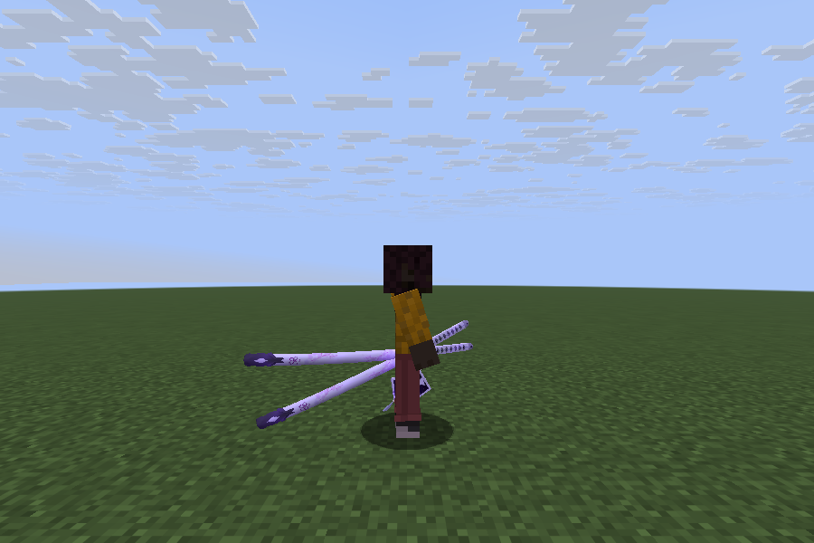 | 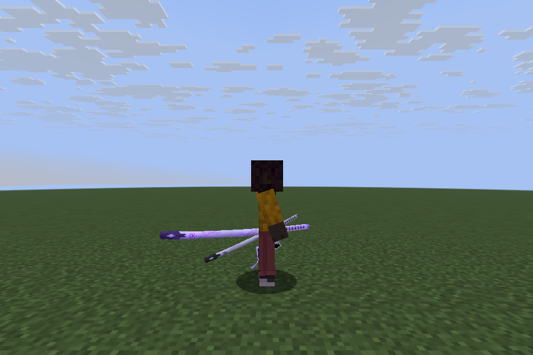 |
| Automatic follow-ups and a one-key burst combo | Timed guard, circular counter, and an optional offhand SA |

[Download the prerelease](https://github.com/Resumresum/slashblade-dual-wield/releases/tag/v0.4.1-experimental) · [Installation](#installation) · [Screenshot gallery — Chinese captions](docs/GALLERY.md) · [Detailed combat reference — Chinese](docs/PLAY_GUIDE.md)

## Pick your blades

Here, **SA** means the blade's own special attack. **R** is this addon's extra key; **V** remains SlashBlade's existing special-movement key.

| Main hand | Offhand | Attacks / movement | Press R |
| --- | --- | --- | --- |
| Long blade | Long blade | Eligible main-blade melee hits trigger a follow-up after about **0.2 seconds**, at **75% base damage** | Eight alternating slashes → simultaneous double strike → main SA → offhand SA → main SA → offhand SA |
| Long blade | Wakizashi / recognized kodachi | Keep the main blade's existing moves | **1-second guard**; the first valid hit gets **80% damage reduction**, triggering a circular counter and **0.8 seconds of invulnerability**; press R again after success for an optional offhand SA |
| Wakizashi / recognized kodachi | Long blade | Quick cut → returning cut → thrust; dash with V, then attack promptly for three thrusts | Offhand forward sweep, about **5 blocks**, with a **2-second** cooldown |
| Wakizashi / recognized kodachi | Wakizashi / recognized kodachi | Main-hand short-blade attacks and dash thrusts | Offhand guard and counter, with the same optional SA follow-up |
| Wakizashi / recognized kodachi | Empty | Main-hand short-blade attacks and dash thrusts | No offhand action |

Paired-blade features require two usable blades. Sealed or broken blades do not qualify. “Recognized kodachi” refers to the currently supported **TwilightTsuki kodachi models**, rather than every third-party sword that looks short.

### Two long blades: keep the cuts coming

Your main blade hits; the second blade follows about **0.2 seconds** later, with its own blade movement, slash particles, and sound. The follow-up adds no extra knockback, launch, or hit stun, and consumes no offhand durability or Proud Souls.

It triggers once per action per target. **75% is a damage multiplier, not a fixed 75 damage.** It uses the main attack's base damage calculation and does not duplicate enchantment bonus damage or independently apply the offhand blade's enchantments. The active burst does not stack this passive onto its own attacks.

For a burst, press **R** once:

**Main → offhand → main → offhand → main → offhand → main → offhand → both → main SA → offhand SA → main SA → offhand SA**

The first eight cuts are spaced **0.3 seconds** apart. The double strike happens at **2.6 seconds**, followed by SA beats at **2.8, 3.0, 3.2, and 3.4 seconds**. The cooldown is **8 seconds**, measured from activation.

During the sequence, both equipment slots are locked, movement speed is reduced by **35%**, turning is limited to **60°** either side of the starting direction, and control immunity is provided. Enemies actually hit are briefly held in place to help subsequent cuts connect; nearby enemies that were not hit are not held. The player can still move.

Melee reach is approximately **5 blocks**. Attack-type SA damage starts at **65%** for the main blade and **45%** for the offhand; healing, shields, and other SA retain their own behavior. Main-blade SA use their normal resource costs; offhand SA during this burst do not consume their own durability or Proud Souls. If a beat cannot release an SA, it falls back to a regular cut.

The main character and arm motions largely reuse SlashBlade's existing animations, with additional offhand blade trajectories. This is not a completely new full-body dual-wield animation set.

### Offhand wakizashi: catch a hit, answer with a counter

Press **R** to enter a **1-second** guard window. The first valid melee or projectile hit that actually damages you receives **80% damage reduction**, ends the guard, and triggers a circular counter.

The counter reaches about **2.5 blocks**, deals **2 base damage**, and lightly knocks nearby valid targets back. You then receive **0.8 seconds of invulnerability**; special damage tagged to bypass invulnerability is excluded.

The guard works from all directions, needs no Thorns enchantment, and does not require standing still. Fire, Thorns, self-inflicted damage, and ordinary environmental damage do not trigger the counter. The circular counter does not independently apply offhand enchantments or spend offhand resources.

After a successful guard, press **R again within 0.8 seconds** to attempt the offhand blade's ordinary SA. This optional SA uses its normal resource costs. Each successful guard provides one attempt; expiry, changing equipment, death, or changing dimensions cancels the opportunity. Sealed, broken, insufficiently enchanted, or otherwise SA-ineligible blades cannot use it.

### Main-hand wakizashi: close in, thrust three times

Left-click through **quick cut → returning cut → thrust**. The shortest interval is **0.2 seconds**; current base multipliers are **44% → 44% → 55%**, with roughly **2.6-block** reach.

Dash using SlashBlade's **V** movement, then left-click **once within 0.6 seconds** to perform three continuous thrusts. Each thrust uses a **23%** base multiplier, with **0.15 seconds** between thrusts and about **3-block** reach. They add no extra knockback. These multipliers participate in the usual weapon, level, and defense calculations; they are not fixed final health loss.

With a long blade in the offhand, **R** adds a forward sweep with roughly **5-block** reach and a **2-second** cooldown. This sweep has no sustained target hold and no extra offhand resource cost.

Hold right-click for the main blade's ordinary SA. The short blade and sheath rise in first person so the original ready flash can enter view, followed by a quick forward-and-down draw cut with a brief pause at the finish. Holding **V** can still use the blade's super SA when its normal requirements are met. The short-blade attack chain has not individually recreated every long-blade Shift combination.

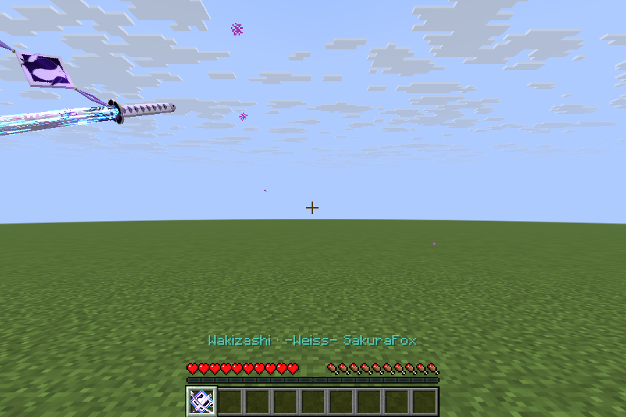

## Forge a matching wakizashi

Make a mold blank, fire it in a furnace, then use a supported long blade as the sample. **The sample blade is returned intact; the mold is consumed.**

### Items

| Wakizashi Mold Blank | Fired Wakizashi Mold | Advanced Wakizashi Mold | Example wakizashi |
| --- | --- | --- | --- |
| 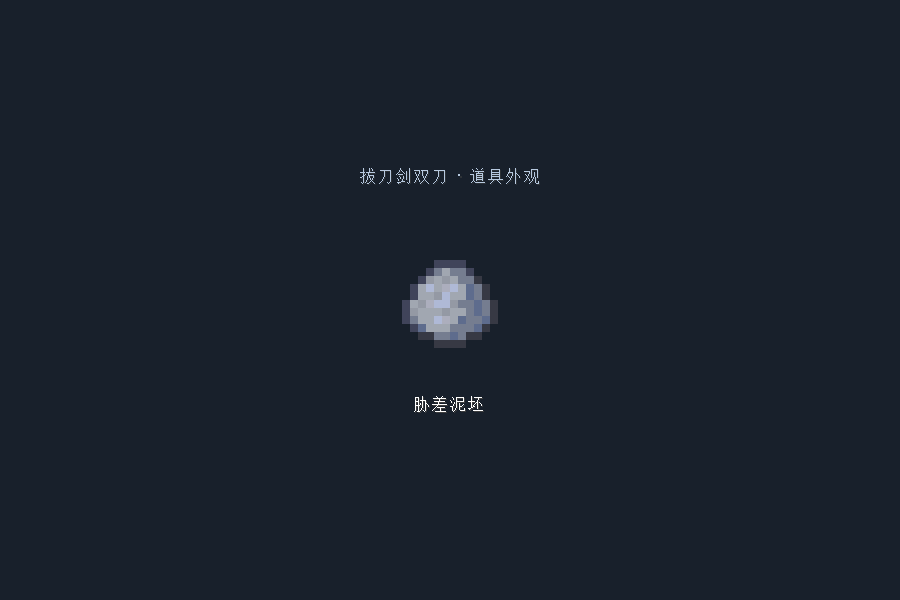 | 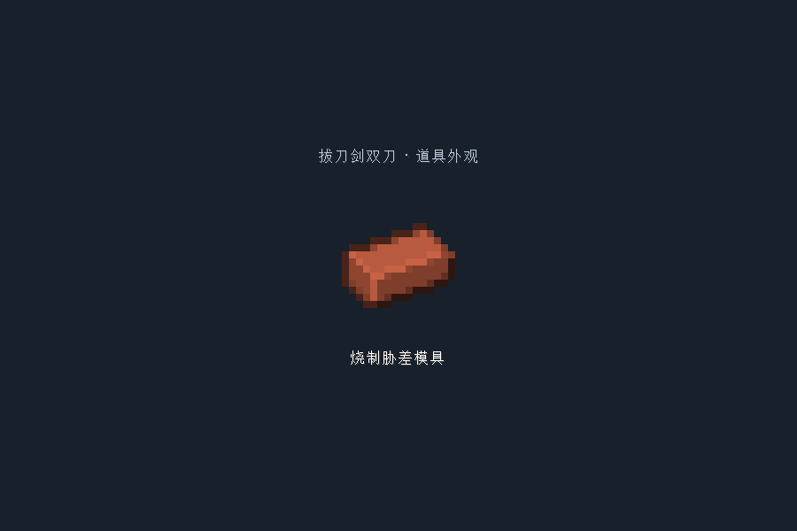 | 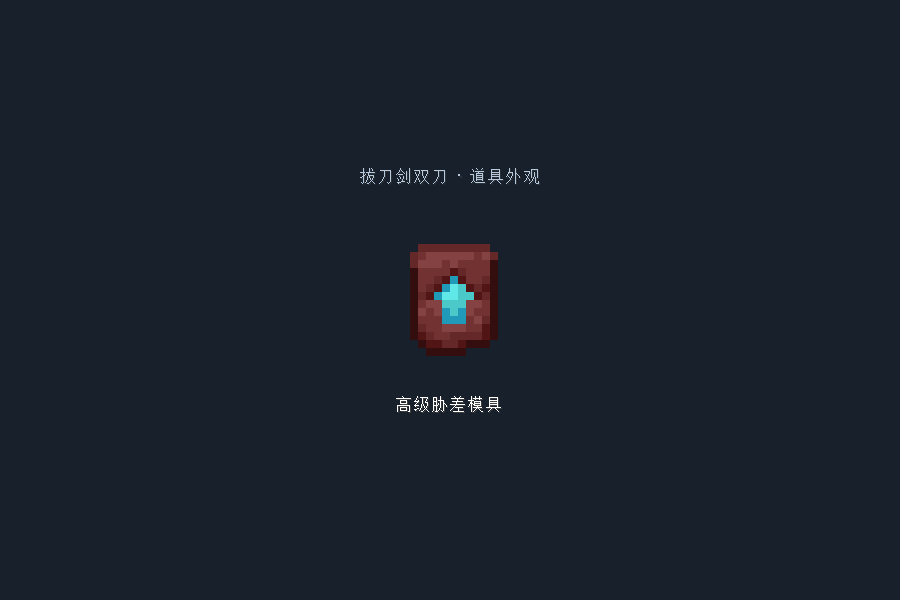 | 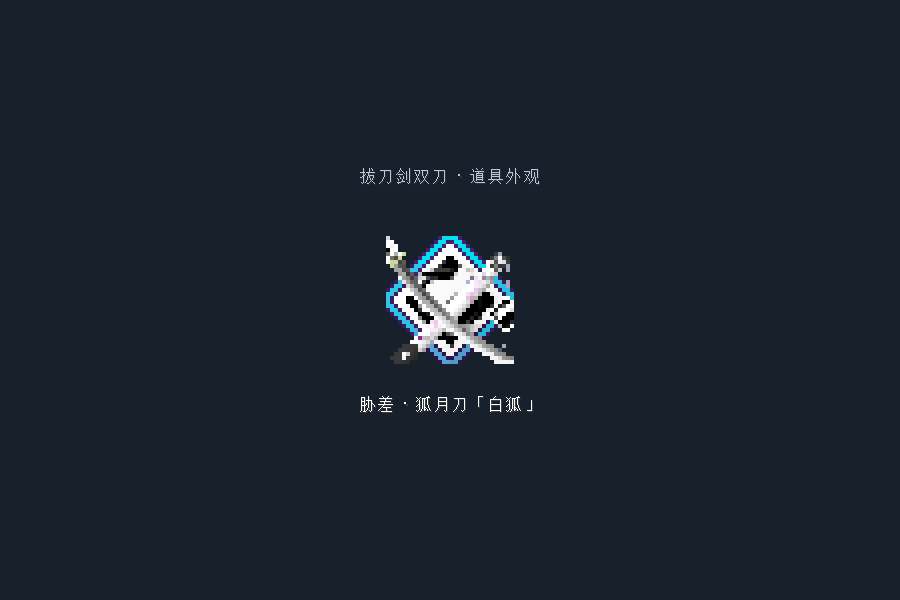 |

These item images use actual in-game renders on a presentation background. The blank, fired mold, and advanced mold currently reuse the vanilla clay-ball, brick, and netherite-upgrade-template icons. The recipe screenshots below show the actual game UI, currently in Chinese.

### 1. Craft the blank

Use **7 clay balls and 1 Nether Star** in a crafting table, leaving the center slot empty.

| Clay ball | Nether Star | Clay ball |
| --- | --- | --- |
| Clay ball | Empty | Clay ball |
| Clay ball | Clay ball | Clay ball |

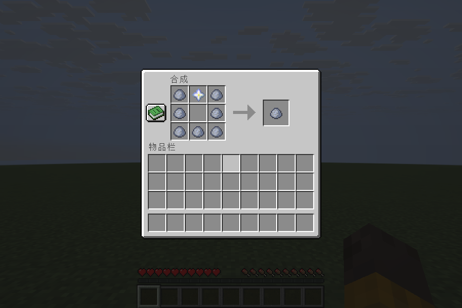

### 2. Fire the mold

Smelt the **Wakizashi Mold Blank** in a **regular furnace** for **10 seconds** to obtain a **Fired Wakizashi Mold**. There is no blast-furnace recipe in this version.

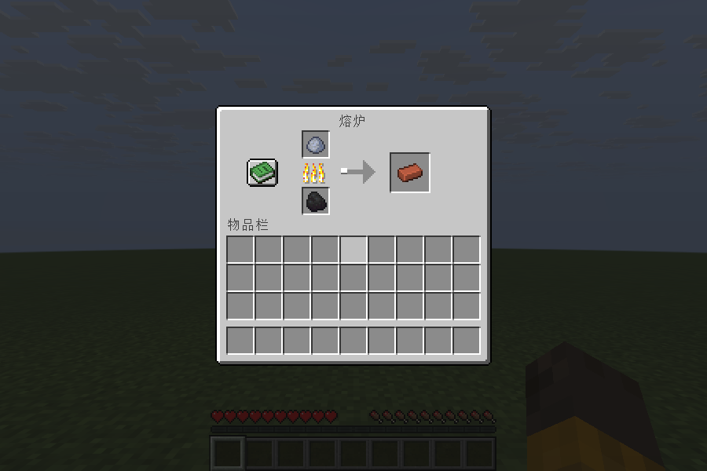

### 3. Make the wakizashi

Combine **one usable long blade and one mold**, in any positions in a crafting table. Take the matching wakizashi; the sample blade is returned intact and the mold is consumed.

Crafted wakizashi render at **70%** of the sample model's scale and use the name **“Wakizashi · [sample blade name]”**. Recognized native kodachi retain their original model scale.

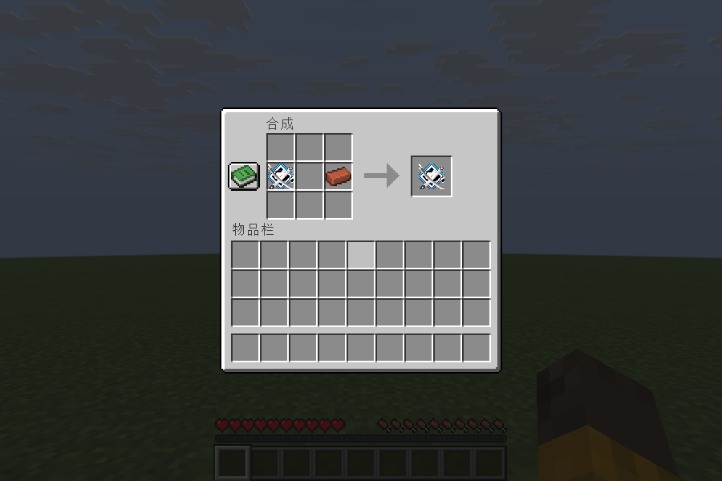

### 4. Upgrade the mold

Combine a **Fired Wakizashi Mold and 1 netherite ingot**, shapelessly, for an **Advanced Wakizashi Mold**.

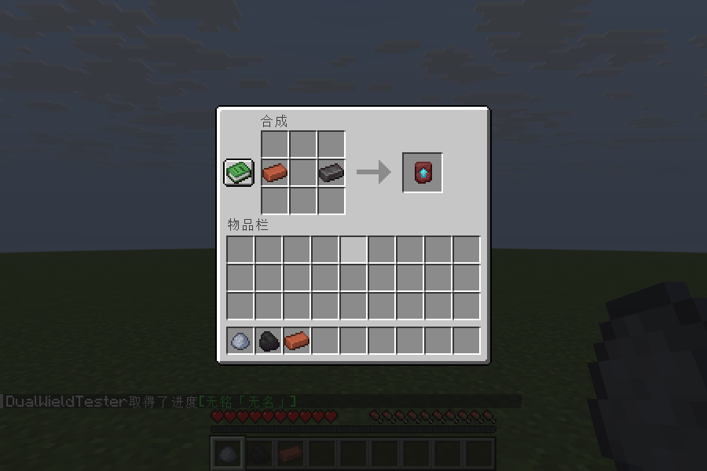

Use it with a long blade to retain more of that blade's supported data. The sample is still returned intact, and the mold is still consumed once.

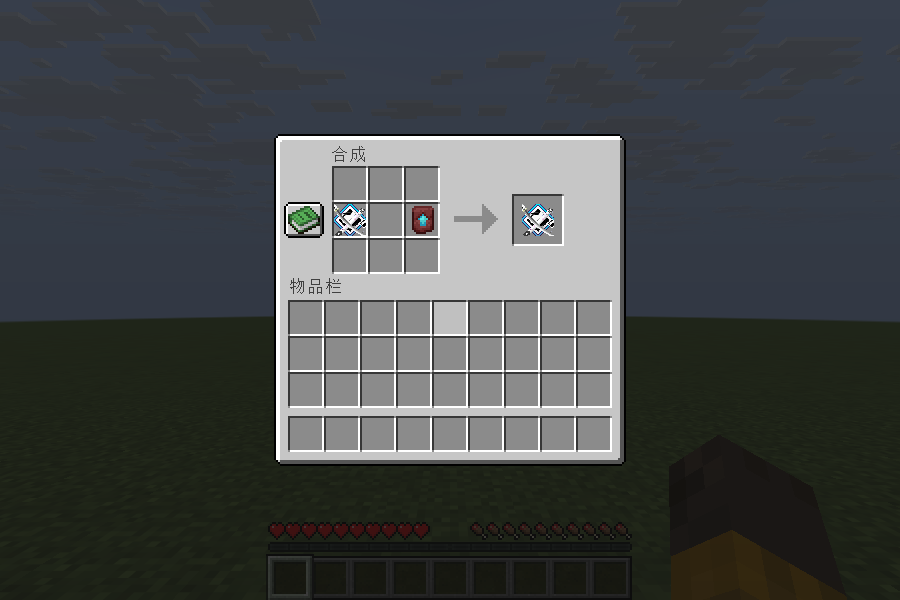

| Data | Fired mold | Advanced mold |
| --- | --- | --- |
| Model, texture, slash color, current ordinary SA | Copied | Copied |
| Enchantments and levels, including curses | Not copied | Copied |
| Kill count, refinement, supported persistent blade settings | Fresh growth | Copied |
| Existing durability wear | Not copied | Copied proportionally |
| Proud Souls | Start from zero | Start from zero |
| Third-party custom item logic or arbitrary extra components | Not guaranteed | Not guaranteed |

Advanced molding copies the supported persistent data, rather than every possible third-party component. The result uses SlashBlade's standard blade item; custom item subclasses and addon-specific abilities may not transfer. Each new blade has its own identity. Temporary combat state and fractional growth remainders are not copied.

Find the three crafting items and generated wakizashi in the **SlashBlade Dual Wield** creative tab. This is also the current in-game keybinding category: the published 0.4.1 build still uses that earlier display name. Search for “Wakizashi” or the sample blade name. JEI / EMI item and dynamic-recipe presentation depends on the installed environment and is not universally verified.

## Fight together, grow together

When the offhand actually joins hits against a target through a follow-up, burst, sweep, counter, or SA, eligible kill-count and Proud Soul rewards are split **70% main blade / 30% offhand blade**. A blade that merely sits in the offhand without participating gets no share.

Visible counters remain integers. Fractional remainders are stored on each blade and survive saving and swapping hands; ten eligible kills can accumulate into seven main-blade kills and three offhand kills. SA resource costs are paid by the blade using the attack and are not split 70/30.

## Installation

Download the playable JAR from [GitHub Releases](https://github.com/Resumresum/slashblade-dual-wield/releases/tag/v0.4.1-experimental). **Code → Download ZIP** downloads source code, not a playable mod.

| Component | Required / tested version |
| --- | --- |
| Minecraft Java Edition | **26.1.2** |
| Fabric Loader | **0.20.1+**; tested with 0.20.1 |
| Java | **25+**; tested with 25 |
| SlashBlade: Refabricated | **`26.1.2-1.5.1-Resharped-2.0.5`** |
| Fabric API | Required by the base mod; tested with `0.155.3+26.1.2` |
| Forge Config API Port | Required by the base mod; tested with `v26.1.5-mc26.1.x-Fabric` |
| This addon | `slashblade-dual-wield-26.1.2-0.4.1-experimental.jar` |

1. Set up the Fabric environment above and confirm SlashBlade works.
2. Exit the game. Put this addon's playable JAR in that instance's `mods` folder. When upgrading, remove the older addon JAR and keep one version installed.
3. Check **Offhand Blade Action** under **Options → Controls → Key Binds → SlashBlade Dual Wield**. The default is **R**; rebind it if needed.
4. Try a separate test world first. Dedicated-server and real multiplayer behavior have not been verified.

Minecraft, SlashBlade, third-party blades, and dependencies are not bundled. Other Minecraft versions, Forge / NeoForge, and similarly named SlashBlade ports are outside this release's verified scope.

**Optional Boss combat patch:** This addon itself does not require Twilight Forest. The separate `slashblade-combat-compat-26.1.2-0.1.0.jar` addresses Hydra part targeting and hostile neutral-mob targeting. It requires **Twilight Forest 4.9.768**, the SlashBlade version above, and **MixinExtras ≥0.5.5**. It retains its own license. Do not install source JARs or test probes as gameplay mods.

## Compatibility and current limits

- Single-player tests cover the base environment, blade appearances in the tested mod set, crafting, data copying, growth, the added combat flows, and controlled Boss checks. [Detailed test scope — Chinese](docs/TESTING.md).
- Blades using standard SlashBlade state and models are the intended compatibility target. **Every addon, unique SA, and custom item is not guaranteed to work.**
- Dedicated servers, real multiplayer, long-term survival, and every third-party ability still need verification. This is a **public prerelease**.
- The optional patch preserves Boss armor and weak points. Small hits against a Hydra's body or closed head can still round down to zero; aim for open mouths.
- Some existing phantom-blade / SA visuals depend on the original skill, model, and camera angle. There is no universal “skill fired” indicator; missing effects alone do not establish whether damage happened.
- Sealed blades follow SlashBlade's existing SA rules.

For bug reports, include the **addon version, both blade names, reproduction steps, and whether the optional patch is installed**, plus relevant logs. Remove private information before sharing logs. [Report an issue](https://github.com/Resumresum/slashblade-dual-wield/issues).

## Credits, license, and development

**R1sum_** provides gameplay design, feature decisions, in-game feedback, and release maintenance. **OpenAI Codex** performed most code implementation, iteration, documentation, and automated verification.

Free use, modification, and free redistribution are allowed with attribution and the license preserved; modified versions must describe their changes. Selling the mod, paid downloads, and paid access to its features are prohibited. Ordinary server operating charges are allowed under the license's exception, provided the mod's features are available to all players on that server. See [LICENSE](LICENSE) for the full terms. This is a **source-available project under a custom license**, not an OSI-approved open-source license.

SlashBlade, third-party blade resources, and the separate combat patch retain their own licenses. The pictured models and textures come from the mods loaded in-game and are not claimed as original assets of this project. See [THIRD_PARTY_NOTICES.md](THIRD_PARTY_NOTICES.md).

[Source and local build instructions — Chinese](docs/BUILDING.md). The public packages exclude local development notes, actual saves, runtime logs, and account configuration.
