# 拔刀剑：胁差与双刀

**双刀接力，胁差迎击。让腰间的第二把刀，也成为战斗的一部分。**

作者：**R1sum_** · GitHub：**Resumresum**  
当前版本：`0.4.1-experimental` · Minecraft `26.1.2` · **Fabric** · 公开测试版

主刀斩落，副刀紧随。八次快斩交替出手，双刀齐斩之后，再接主副刀交替的四拍 SA——想把输出一口气打出来，就带上两把长刀。

也可以在副手留一把胁差：迎住来袭的一击，反斩扫开近身的敌人，再决定是否追上一记 SA。把胁差换到主手，则能用快斩、回斩与突进后的连续三刺，打出更紧凑的近身节奏。

**《拔刀剑：胁差与双刀》**是 **SlashBlade: Refabricated** 的玩法附属。新增操作只用一个可改键的「副刀动作」键，默认 **R**；不同主副手搭配，对应不同的出招方式。你还可以用喜欢的长刀制作同款胁差，把熟悉的外观带进新的打法，让实际参与战斗的副刀一起成长。

**开发方式声明：本模组主要通过 OpenAI Codex 实现想法。大部分代码实现、迭代修改和自动验证由 Codex 完成。**

| 双长刀 | 长刀＋胁差 |
| --- | --- |
| 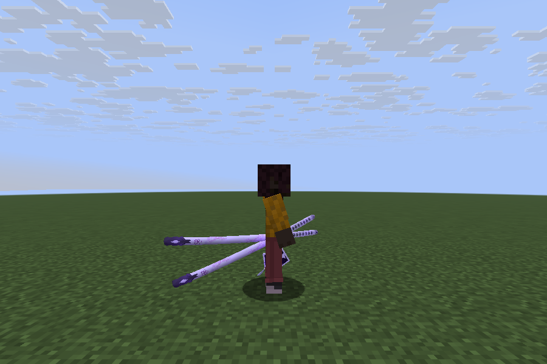 | 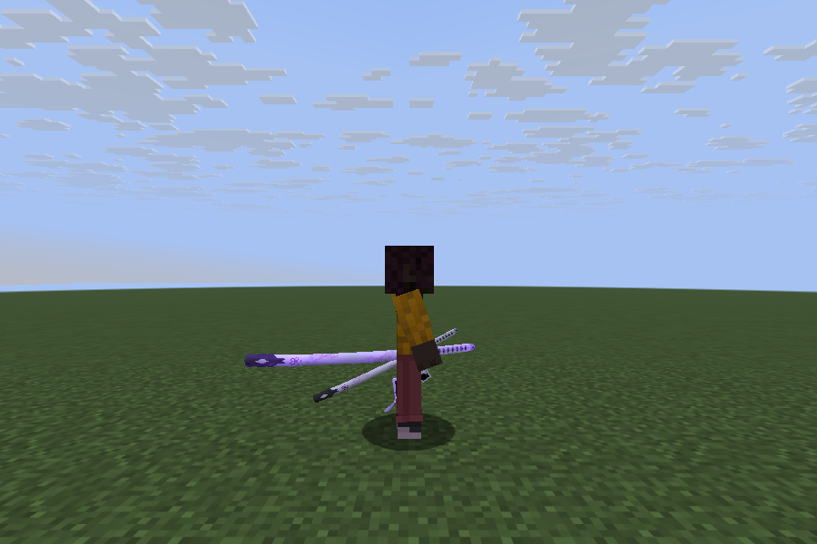 |
| 自动跟斩＋一键连续爆发 | 一键招架＋环形反击＋可选副刀 SA |

[下载试玩](https://github.com/Resumresum/slashblade-dual-wield/releases/tag/v0.4.1-experimental) · [安装要求](#安装与版本要求) · [完整截图展示](docs/GALLERY.md) · [详细玩法与数值](docs/PLAY_GUIDE.md) · [更新说明](CHANGELOG.md) · [测试范围](docs/TESTING.md)

## 选好搭配，拔刀上场

**主手和副手的位置会改变玩法。**下表的 R 都指同一个「副刀动作」键，V 仍是拔刀剑本体的特殊移动键。

| 主手 | 副手 | 普通攻击 / 移动 | 按 R |
| --- | --- | --- | --- |
| 长刀 | 长刀 | 主刀普通刀招命中后约 **0.2 秒**追加一次 **75% 基础伤害**的副刀跟斩 | 八次主副交替快斩 → 双刀齐斩 → 主 SA → 副 SA → 主 SA → 副 SA |
| 长刀 | 胁差 / 已识别小太刀 | 继续使用主刀原有招式 | **1 秒招架**；受击减伤 **80%**，自动环形反击并获得 **0.8 秒无敌**；成功后再按 R 可追加副刀普通 SA |
| 胁差 / 已识别小太刀 | 长刀 | 左键快斩 → 回斩 → 短刺；V 突进后及时左键可三连刺 | 副长刀向前扇形横斩，约 **5 格**，冷却 **2 秒** |
| 胁差 / 已识别小太刀 | 胁差 / 已识别小太刀 | 主手短刀快攻与突进三连刺 | 副手招架反击，同样可在成功后追加副刀普通 SA |
| 胁差 / 已识别小太刀 | 空手 | 主手短刀快攻与突进三连刺 | 没有副刀动作 |

新增的双刀功能要求两把刀均可用；封印或损坏的刀不满足条件。这里的「小太刀」特指当前识别的 TwilightTsuki 小太刀模型，并非所有外观较短的第三方刀。

### 双长刀：刀接刀，直到四拍 SA 收尾

主刀命中，副刀接上。装备两把长刀后，每次符合条件的主刀普通刀招命中，约 **0.2 秒**后都会带出一次副刀短斩，配有刀光与音效。跟斩不额外击退或击飞目标，也不额外消耗副刀的耐久、耀魂。同一动作对同一目标只补一次，不会把每一段命中都再复制一遍。**75% 是伤害计算倍率，不是固定 75 点伤害，也不复制副刀附魔。**

想把节奏推快，按一次 **R**：前八刀每 **0.3 秒**主副交替出手，随后双刀齐斩，再交替释放四次 SA。爆发期间锁住双手装备、减速 35%、限制转向并提供免控；实际命中的怪物会被短暂限制移动，便于接上后续攻击。冷却从启动时起算 **8 秒**。

四拍 SA 使用两把刀各自的普通 SA，不会让没有 SA 的刀凭空获得能力。能否释放、资源消耗以及攻击型 SA 的倍率见[详细玩法](docs/PLAY_GUIDE.md)。

### 胁差副手：迎住一击，把反击的机会握在手里

敌人贴近时，按 **R** 举刀招架。在接下来的一秒内，第一次实际受到的有效近战或弹射物攻击减伤 **80%**，随后自动扫开身边约 **2.5 格**内的有效目标，造成轻伤害和轻微击退，并获得 **0.8 秒无敌**。不需要荆棘附魔，也不要求站定或精确卡住一瞬间。

招架成功后的 **0.8 秒内再按一次 R**，可以追加副手胁差自己的普通 SA。它会按正常规则消耗副刀的耀魂或耐久；不按就只进行反击，不会自动交掉 SA。环境伤害不能触发招架反击，封印、损坏、未满足本体附魔要求或没有可用 SA 的刀不能追加 SA。

### 胁差主手：突进贴身，三刺连发

把胁差握到主手，出招也跟着变快。左键依次打出 **快斩 → 回斩 → 短刺**；想追上目标，就用本体 **V** 完成方向突进，随后在 **0.6 秒内按一次左键**，会连续刺三下，相邻两刺间隔 **0.15 秒**，不需要再按三次。

长按右键仍使用该刀自带的普通 SA。第一人称蓄力时会抬起短刀与刀鞘，让原有蓄满闪光进入视野；成功释放 SA 时快速向前下方斩出，并在收势处短暂停顿。满足本体条件的刀也可使用长按 V 的超级 SA，不能绕过刀具原有要求。

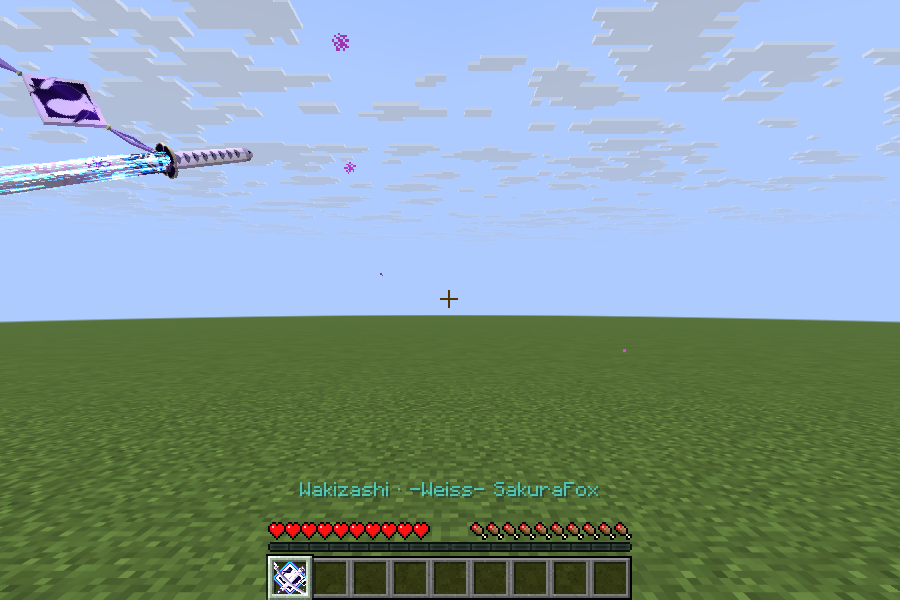

## 把喜欢的长刀，做成随身的胁差

用下界之星与黏土制作泥坯，送进熔炉烧成模具，再以一把长刀作为样板，制作对应的胁差。**样板长刀完整返还，模具使用一次后消耗。**

### 新道具外观

| 胁差泥坯 | 烧制胁差模具 | 高级胁差模具 | 胁差示例 |
| --- | --- | --- | --- |
| 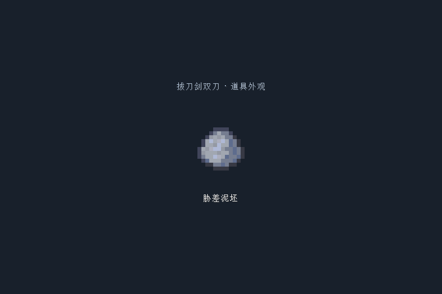 | 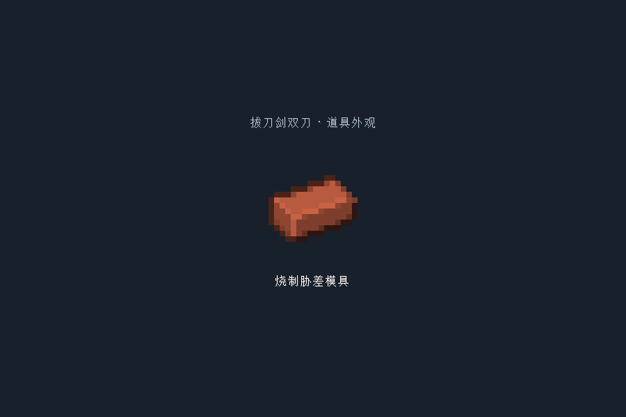 | 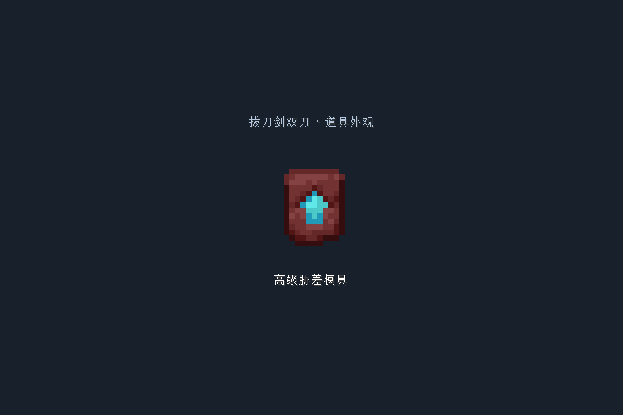 | 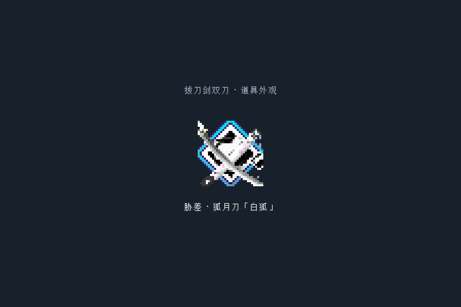 |

以上道具图使用当前游戏的实际物品渲染，深色展示底板仅用于文档。泥坯、烧制模具和高级模具目前分别借用黏土球、红砖与下界合金升级模板的原版图标，名称和用途与原版物品不同。胁差示例使用白狐样板，不同刀型的持握模型见[实机展示](docs/GALLERY.md)。

### 1. 合成泥坯

在工作台按下表放入 **7 个黏土球＋1 颗下界之星**。中间一格留空。

| 黏土球 | 下界之星 | 黏土球 |
| --- | --- | --- |
| 黏土球 | 留空 | 黏土球 |
| 黏土球 | 黏土球 | 黏土球 |

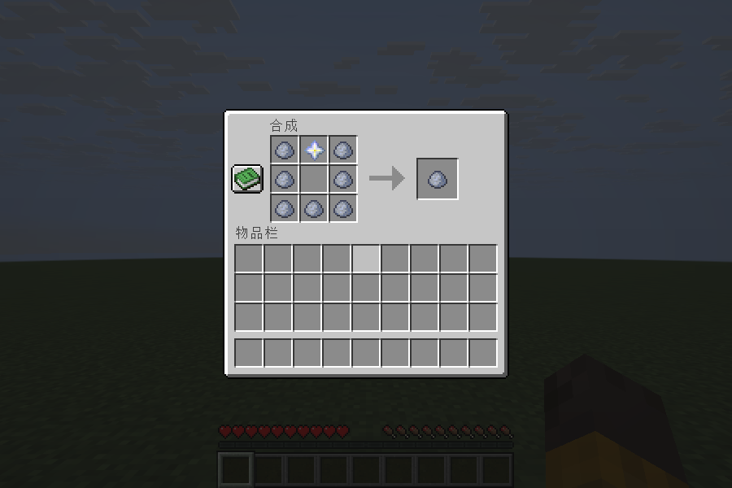

### 2. 烧制模具

把「胁差泥坯」放进**普通熔炉**，烧制成「烧制胁差模具」。本版烧制时间为 **10 秒**；没有高炉配方。

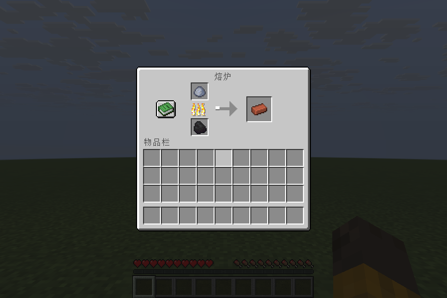

### 3. 用长刀成型

工作台中放入 **一把可用长刀＋一个模具**，位置不限，取出对应胁差。**样板长刀完整返还，模具消耗一次。**制作出的胁差以样板模型的 **70%** 大小显示，名字使用「胁差 · 样板刀名」。

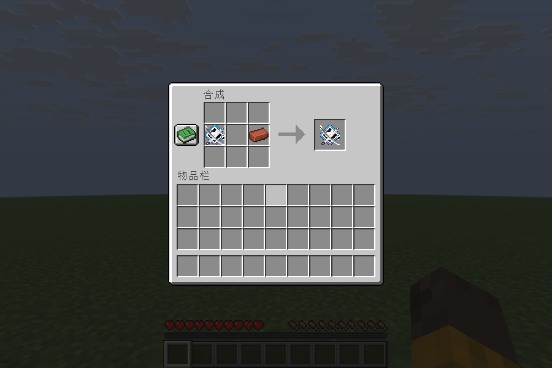

### 4. 升级为高级模具

想保留养成和附魔，可以先用 **烧制胁差模具＋1 块下界合金锭**无序合成「高级胁差模具」。

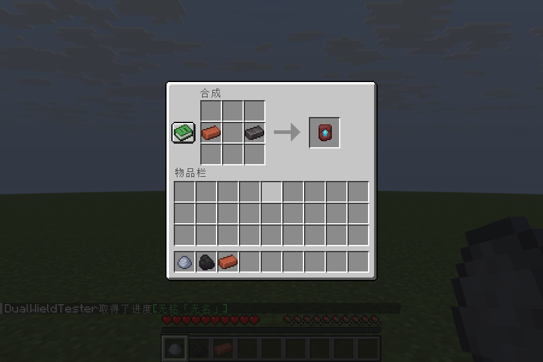

再把 **长刀＋高级胁差模具**放进工作台，制作继承更多数据的胁差；同样返还样板长刀、消耗模具一次。

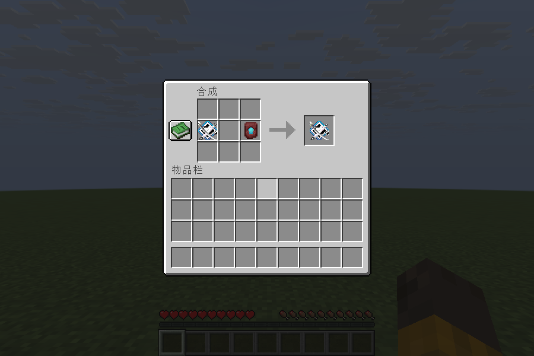

| 继承内容 | 普通模具 | 高级模具 |
| --- | --- | --- |
| 模型、贴图、刀光颜色、当前普通 SA | 继承 | 继承 |
| 附魔及等级，包含诅咒 | 不复制 | 继承 |
| 击杀数、精炼及已支持的持久刀具设置 | 从新刀开始 | 继承 |
| 样板的耐久磨损 | 不复制 | 按比例继承 |
| 耀魂 | 从零积累 | 从零积累 |
| 第三方独立物品逻辑、任意额外组件 | 不保证继承 | 不保证继承 |

高级模具提供的是**已支持数据的近完整复制**。成品使用本体标准拔刀剑物品承载，不保证复制其他附属独立物品类实现的全部能力。

创造模式中打开「**拔刀剑双刀**」物品栏，可找到泥坯、两种模具，以及根据当前加载刀具生成的胁差。可搜索「胁差」或样板刀名；物品列表与动态配方在不同 JEI / EMI 环境下的展示需要分别验证，本版不承诺所有动态配方都有完整查看页。

## 并肩出刀，也并肩成长

当副刀实际参与了对目标的跟斩、爆发、横斩、反击或 SA，相关战斗奖励按 **主刀 70% / 副刀 30%** 分配。只是放在副手、没有参与命中的刀不分成。

击杀数和耀魂最终仍显示整数，小数余量保存在对应刀上，换手与存档后继续累计。例如十次符合条件的击杀可累计成主刀 7 次、副刀 3 次。释放 SA 的资源消耗仍由对应刀承担，**不会把消耗也按 70/30 分摊**。

## 安装与版本要求

请从本项目的 GitHub **Releases** 下载游玩 JAR。GitHub 的 **Code → Download ZIP** 是源码，不能直接放入 `mods`。

| 项目 | 本版对应环境 |
| --- | --- |
| Minecraft Java Edition | **26.1.2** |
| 模组加载器 | **Fabric Loader 0.20.1 或更高**；已测 0.20.1 |
| Java | **25 或更高**；已测 Java 25 |
| 拔刀剑本体 | **SlashBlade: Refabricated `26.1.2-1.5.1-Resharped-2.0.5`** |
| 本体前置 | Fabric API、Forge Config API Port；测试分别使用 `0.155.3+26.1.2`、`v26.1.5-mc26.1.x-Fabric` |
| 双刀附属 | `slashblade-dual-wield-26.1.2-0.4.1-experimental.jar` |

1. 准备上述 Fabric 游戏环境，先确认拔刀剑本体能正常运行。
2. 退出游戏，将双刀附属的游玩 JAR 放入该实例的 `mods` 文件夹；升级时移走旧版，保留一份双刀附属。
3. 进入游戏，在「选项 → 控制 → 按键绑定 → 拔刀剑双刀」中检查「副刀动作」，默认 **R**。若与其他模组冲突，改成一个空闲键。
4. 先在新建测试世界体验，再用于自己的长期存档。当前版本尚未完成独立服务器和真实多人联机验证。

本项目不打包 Minecraft、拔刀剑本体、第三方刀具模组或它们的前置。其他 Minecraft 版本、Forge / NeoForge，以及名称相似的拔刀剑移植版，均不在本版验证范围内。

**可选 Boss 战斗补丁：**双刀附属本身不要求暮色森林。需要九头蛇部位受击与敌对中立单位索敌修复时，可额外安装单独的 `slashblade-combat-compat-26.1.2-0.1.0.jar`；它要求暮色森林 **4.9.768**、上表中的拔刀剑，以及 **MixinExtras ≥0.5.5**。不要把 `sources.jar` 或测试探针放进 `mods`。详见[测试与兼容说明](docs/TESTING.md)。

## 兼容范围与已知限制

- 已在独立单人实例中验证本体环境，以及当前测试整合中的刀具外观、短刀招架和新增战斗流程。详细项目与原始结果见[测试范围](docs/TESTING.md)。
- 设计上支持读取标准拔刀剑状态与模型的刀；**不等于所有拔刀剑附属、所有独有 SA 和所有自定义物品都已完全兼容**。
- 独立服务器、真实多人联机、长期生存流程及所有第三方专属能力尚待验证。当前以 **Pre-release / 公开测试版**发布。
- 可选战斗补丁保留 Boss 原本的护甲与弱点规则。九头蛇身体和闭嘴头仍可能把低伤害单次攻击折算为 0；应优先攻击张嘴时的头部。
- 部分原有幻影刃 / SA 的视觉可见性仍取决于本体技能、模型和视角；当前没有统一的「技能已发出」提示。看不到特效不能单凭这一点判断没有结算伤害。
- 封印刀的 SA 提示与可用性沿用本体规则，不额外给封印刀补上 SA。

遇到问题时，请记录 **模组版本、主副手刀名、复现步骤、是否装有可选补丁**，并附上相关日志；发布后可在本仓库 Issues 反馈。分享日志前请自行去除私人信息。

## 署名、许可与开发说明

玩法设计、取舍、实机体验反馈与发布维护：**R1sum_**。本模组主要通过 **OpenAI Codex** 将这些玩法想法实现；大部分代码实现、迭代修改、文档编写与自动验证由 Codex 完成。它是使用 AI 开发工具实现的玩法项目，测试范围与限制如上所列。

允许免费使用、修改和免费分发，须保留署名及许可，修改版需说明改动；禁止售卖模组、收费下载，以及付费解锁本模组功能。允许正常服务器运营收费，但本模组功能应对该服务器所有玩家开放。完整条款见 [LICENSE](LICENSE)。本项目按自定义的源码可用许可发布，不以 OSI 开源许可宣传。

拔刀剑本体、第三方刀具资源与独立战斗兼容补丁各自适用其原有许可；本项目的限制不覆盖它们。模型与贴图展示来自游戏中实际加载的刀具，不代表这些资源由本项目原创。详见[第三方说明](THIRD_PARTY_NOTICES.md)。

开发源码与构建说明见 [docs/BUILDING.md](docs/BUILDING.md)。公开包不包含本机开发笔记、实际存档、运行日志或账号配置。
