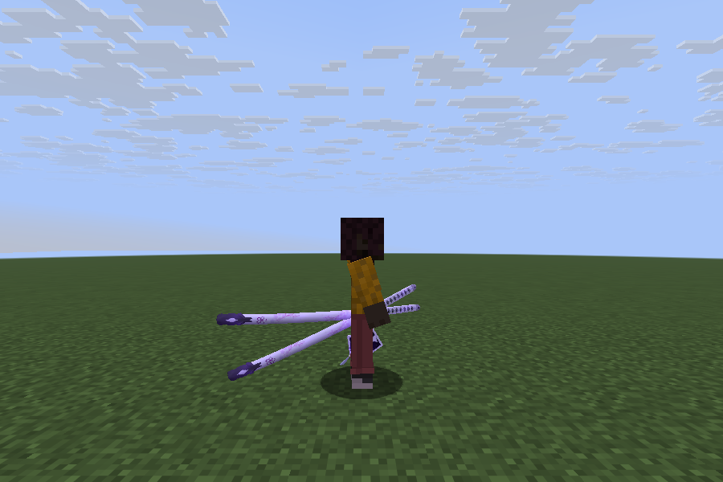
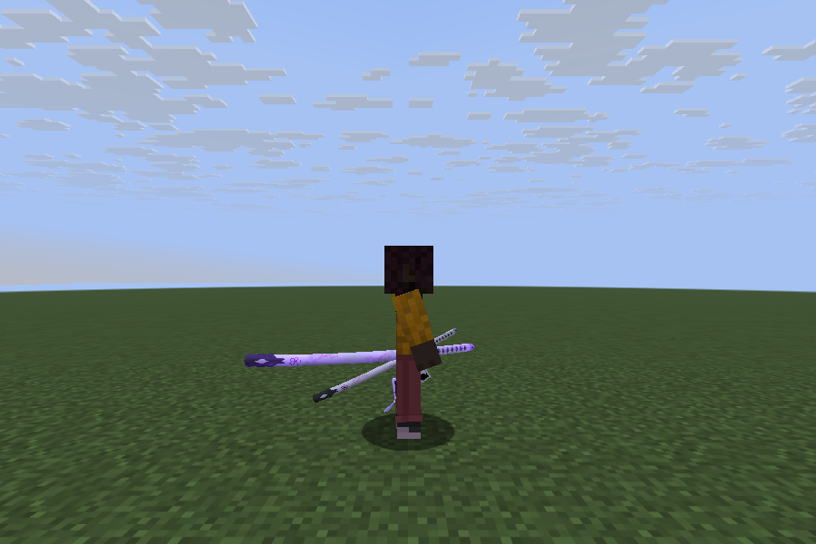
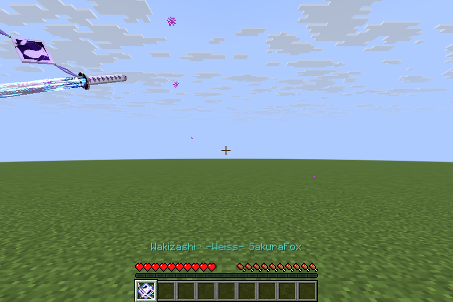
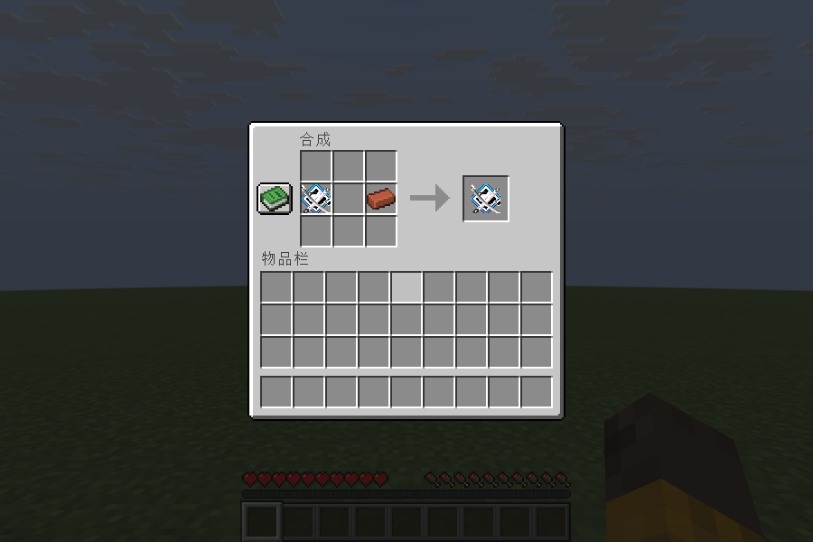

# 论坛发布帖草稿

状态：尚未投递。正式发帖前，补入实际 GitHub 发布链接，并按所选论坛的现行版规填写分类、标题与前置说明。

建议标题：**[26.1.2 / Fabric] 拔刀剑双刀：自动跟斩、一键爆发与胁差招架｜0.4.1 公开测试**

---

大家好，我是 R1sum_。这是我为 SlashBlade: Refabricated 设计的一套双刀玩法，希望让两把长刀和长刀搭配胁差拥有各自的战斗节奏。新增操作只用一个可改键的「副刀动作」，默认 R。

**双长刀偏向连续输出。**主刀普通刀招命中后，副刀会在约 0.2 秒后追加一次 75% 基础伤害的跟斩，不增加额外击退。按 R 可以打出八次交替快斩、双刀齐斩，再接主副刀交替的四拍 SA。

**副手胁差偏向招架反击。**按 R 进入 1 秒招架窗口，第一个有效受击减伤 80%，自动扫开身边目标并获得 0.8 秒无敌。招架成功后，可以再按 R 追加一次副刀普通 SA，也可以保留资源，只使用反击。

**主手胁差拥有自己的快攻。**左键是快斩、回斩、短刺；V 突进后及时按一次左键，会连续刺三下。主短副长的搭配还可以按 R 使用副长刀的前方横斩。

胁差通过泥坯、烧制模具和样板长刀制作，样板会完整返还。高级模具可继承已支持的附魔与养成数据，耀魂重新积累。副刀实际参与命中后，可分得相关战斗击杀与耀魂奖励的 30%。

下面是独立测试世界的实机截图。刀具模型与贴图来自相应本体或附属，须自行安装对应模组。

目前版本为 **0.4.1-experimental 公开测试版**，对应 **Minecraft 26.1.2、Fabric Loader 0.20.1+、Java 25+、SlashBlade: Refabricated 26.1.2-1.5.1-Resharped-2.0.5**，需要本体前置 Fabric API 和 Forge Config API Port。双刀附属本身不要求暮色森林，可选 Boss 战斗兼容补丁有独立依赖和许可。

已经做过独立单人实例的配方、成长和战斗验证；真实多人联机、独立服务器和所有第三方独有能力还没有完成验证。欢迎先用独立世界试玩，再反馈主副手刀名、版本和复现步骤。完整安装要求、配方、许可和已知限制以项目 README 为准。

**开发方式声明：本模组主要通过 OpenAI Codex 实现我的玩法想法；我负责构思、功能取舍和实机反馈，大部分代码实现、迭代修改与自动验证由 Codex 完成。**

允许保留署名的免费使用、修改和免费分发，禁止售卖、收费下载及付费解锁本模组功能；正常服务器运营适用许可中的例外。第三方资源与独立兼容补丁保留各自许可。

下载与完整说明：正式上线后补入 GitHub 仓库及 Releases 链接。反馈优先汇总至该仓库 Issues。
