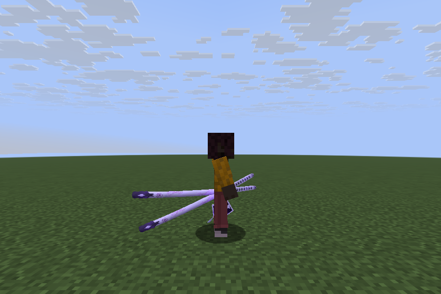
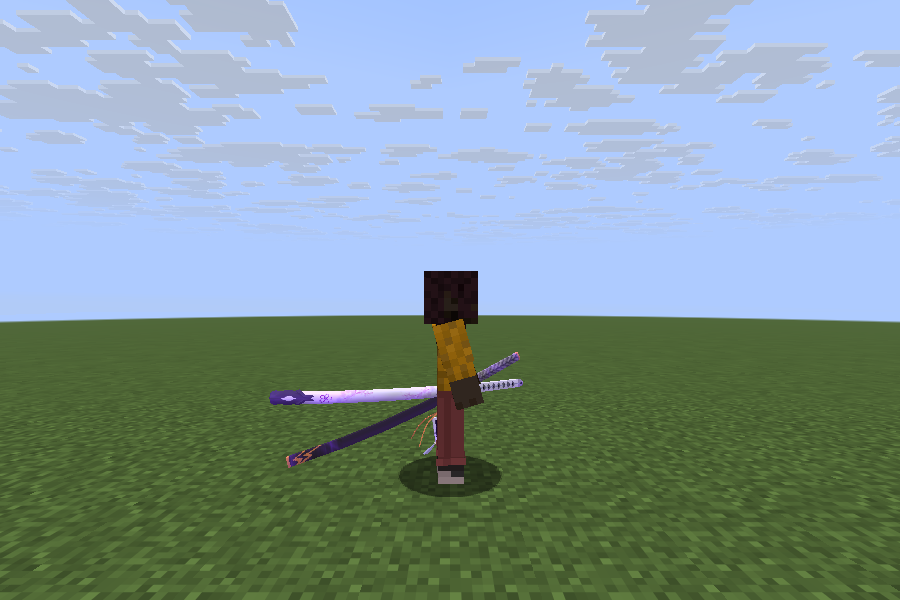

# 实机展示 / Gameplay gallery

[返回首页](../README.md) · [English](../README.en.md) · [玩法说明](PLAY_GUIDE.md)

## 当前动作 / Current moves · 0.4.12-experimental

五段均以当前动作代码在独立测试世界重新录制，正常速度、无声。常规目标关闭 AI、400 点生命；招架片段额外使用一次真实敌方攻击触发反击。白狐刀型是示例，不代表所有刀型与 SA。

All five clips were freshly recorded with the current motion code, at normal speed without audio. Regular targets have AI disabled and 400 HP; the guard clip uses one real enemy attack to trigger the counter. White Fox blades are examples.

| 双长刀十二连斩＋齐斩 / Twelve cuts + double strike | 胁差基础三段 / Wakizashi basic chain |
| --- | --- |
|  |  |

爆发片段仅展示十二次交替快斩与齐斩，后续四拍 SA 与普通斩击兜底不在片段内。The burst clip ends after the double strike; it does not show the four SA beats or fallback cuts.

| 突进三连刺 / Dash into triple thrust | 自动跟斩 / Automatic follow-up |
| --- | --- |
|  |  |

**胁差招架反击 / Wakizashi guard and counter**

## 装备外观 / Equipment views

以下为早期独立测试世界的原始装备截图，保留用于展示本版沿用的挂载、长度和模型区别；不作为当前动作节奏或伤害的证据。旧动作静帧已从展示中移除。模型和贴图来自相应本体或附属资源，须安装提供它们的模组。

These earlier unaltered equipment screenshots show the retained mounting, size, and model differences. They are not evidence of current motion timing or damage. Models and textures belong to their respective mods.

### 双长刀：同侧错角 / Two long blades

| 正面 / Front | 侧面 / Side |
| --- | --- |
|  |  |

### 长刀＋胁差 / Long blade + wakizashi

制作胁差以样板模型的 70% 显示；已识别的原生小太刀保留原比例。Crafted wakizashi use 70% of the sample model's scale; recognized native kodachi keep their original scale.

| 正面 / Front | 侧面 / Side |
| --- | --- |
|  |  |

### 其他模型 / Other models

| 其他长刀 / Other long blade | 原生小太刀 / Native kodachi |
| --- | --- |
|  |  |

四张道具渲染与五张工作台／普通熔炉配方截图见[首页制作流程](../README.md#把喜欢的长刀做成随身的胁差)。这些实机图保留用于本版未改变的配方与物品介绍；历史拍摄记录见[测试范围](TESTING.md)。

See the [README crafting steps](../README.en.md#forge-a-matching-wakizashi) for four item renders and five in-game crafting/furnace screenshots. These illustrate the retained recipes; their historical capture scope is documented in [TESTING](TESTING.md).
