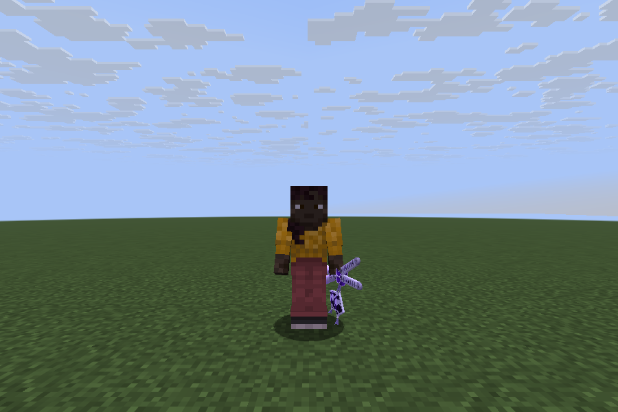
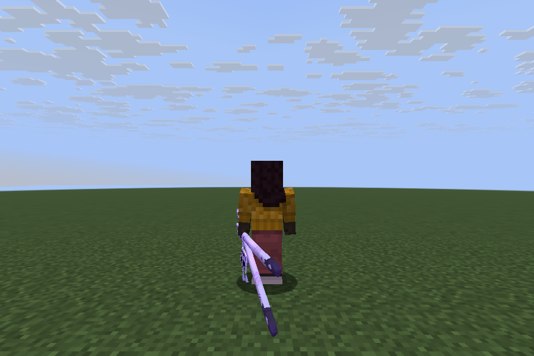
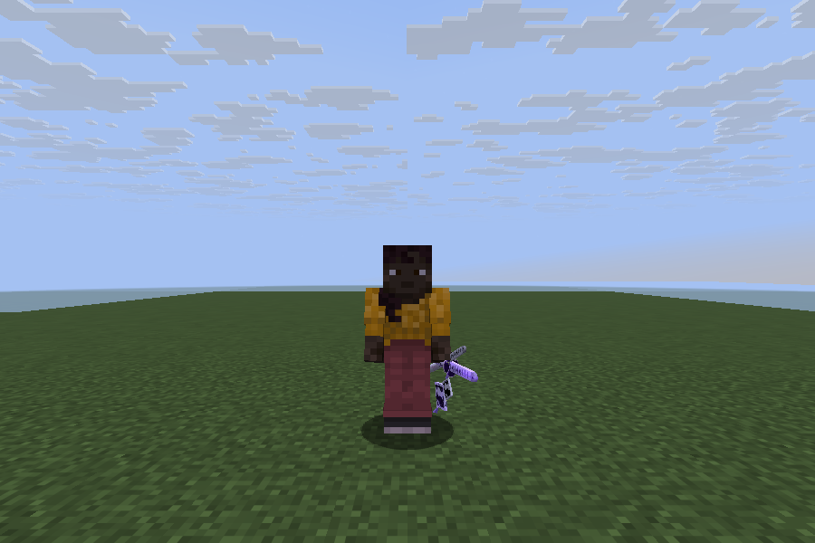
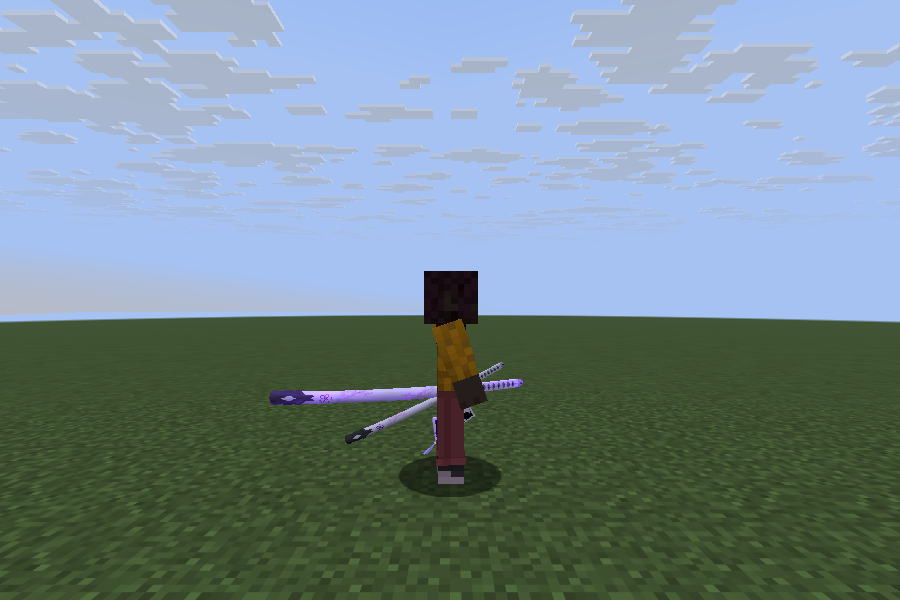
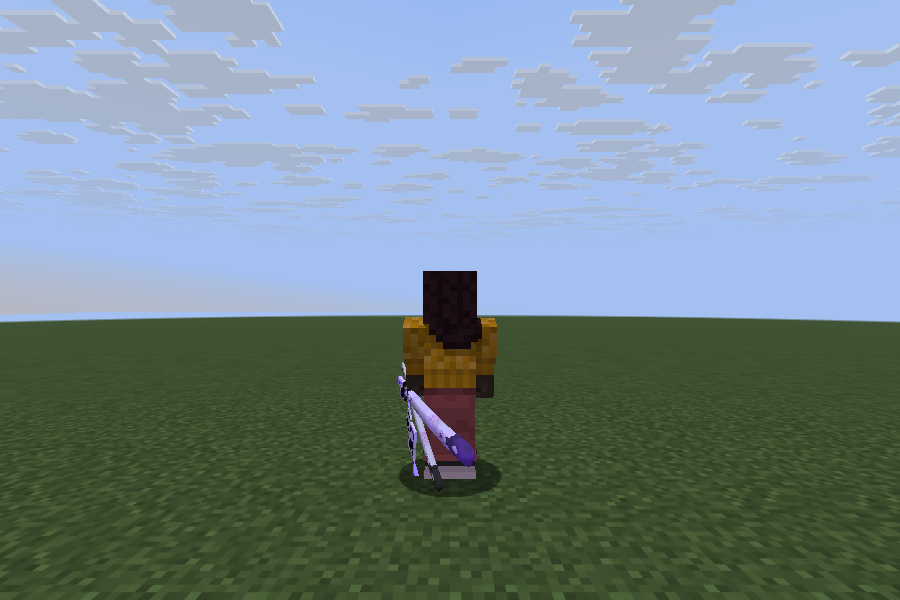
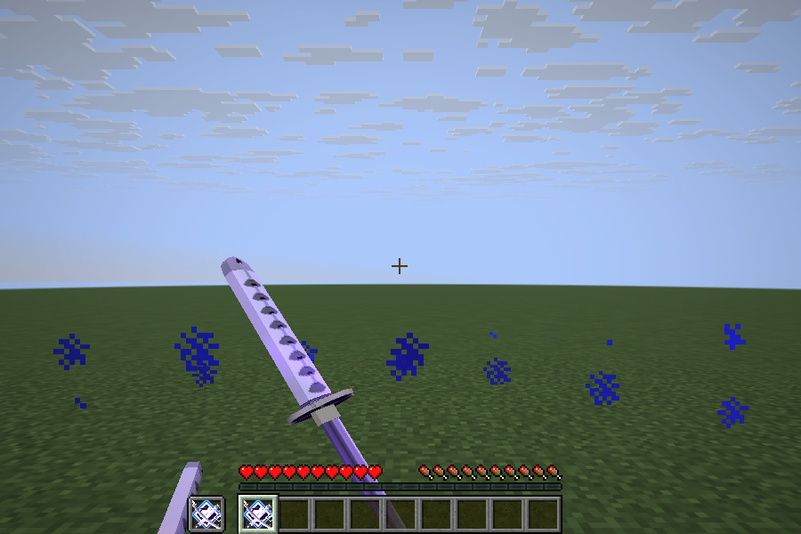
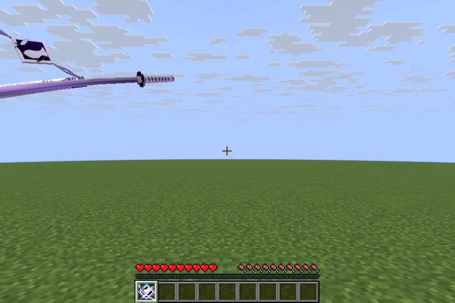
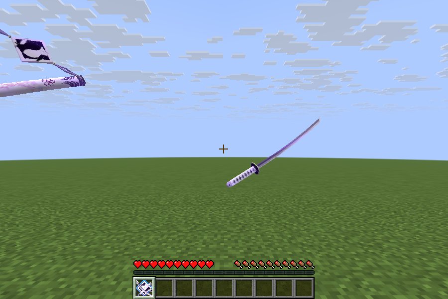
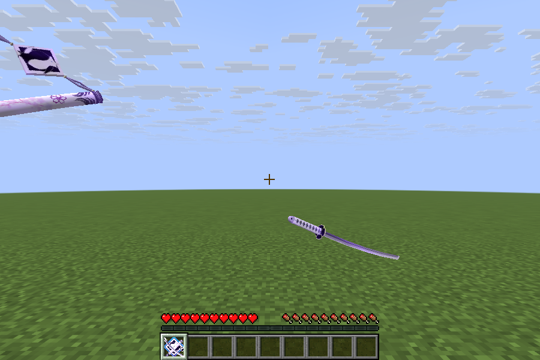
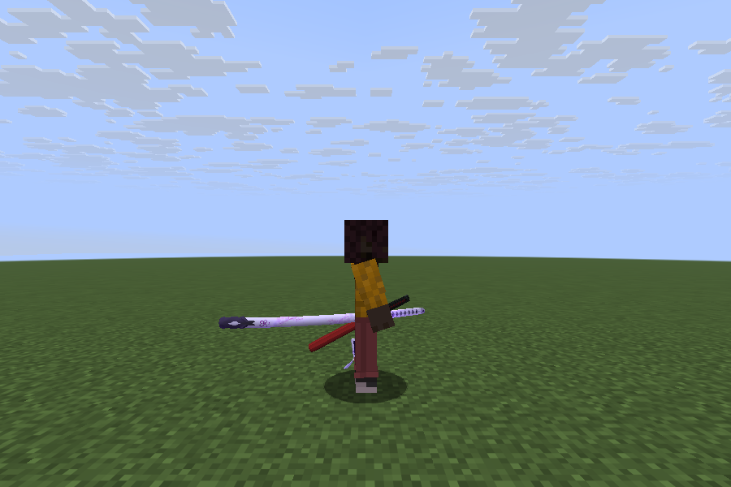

# 实机截图展示

[返回首页](../README.md) · [玩法说明](PLAY_GUIDE.md)

泥坯、两种模具与胁差的道具图，以及工作台、熔炉中的实际配方截图，放在[首页「如何获得胁差」](../README.md#如何获得胁差)各步骤旁边，方便对照材料和产物。

以下均为独立测试世界的原始截图，没有重画或合成游戏效果。图片采集于 `0.4.0` 的视图检查，展示沿用到 `0.4.1` 的挂载与第一人称动作；`0.4.1` 新增的 Boss 兼容处理不靠这些截图证明。截图中的刀具模型和贴图来自相应的拔刀剑本体或附属资源，须安装提供它们的模组。

## 双长刀：同侧挂载，刀柄错角

主副刀鞘口靠近，同侧错开角度。带独立刀鞘的模型在副刀出刀时将刀鞘留在腰间。

| 正面 | 侧面 |
| --- | --- |
|  |  |

## 长刀＋胁差：相同刀型，不同长度

制作出的胁差按样板模型的 70% 缩放。下图展示同款长刀与胁差的长度及挂载区别。

| 正面 | 侧面 |
| --- | --- |
|  |  |

## 第一人称：副刀跟斩出刀姿态

这张空场动作截图展示副刀出刀与刀光，不展示实际对怪物的伤害。跟斩的伤害、时序和去重已另做受控验证。

## 胁差蓄力与 SA 出刀

**抬刀蓄力 → 抽刀 → 快速向前下方斩出 → 收势短暂停顿。**

| 蓄满：抬起刀鞘，闪光进入视野 | 抽刀 |
| --- | --- |
|  |  |

| 斩出过程中的一个采样帧 | 收势停顿 |
| --- | --- |
|  |  |

静态截图只展示动作的采样帧，不能完整表达挥刀速度，也不能代表所有刀型、所有 SA 的特效。

## 其他刀型示例

| 其他长刀的副手挂载 | 已识别原生小太刀 |
| --- | --- |
|  |  |

测试中的额外侧视检查覆盖 45 把刀，实际短刀招架检查覆盖 73 把制作胁差和 5 把原生小太刀。外观与基础流程的通过，不代表每把刀的第三方独有能力均已验证；详见[测试范围](TESTING.md)。
